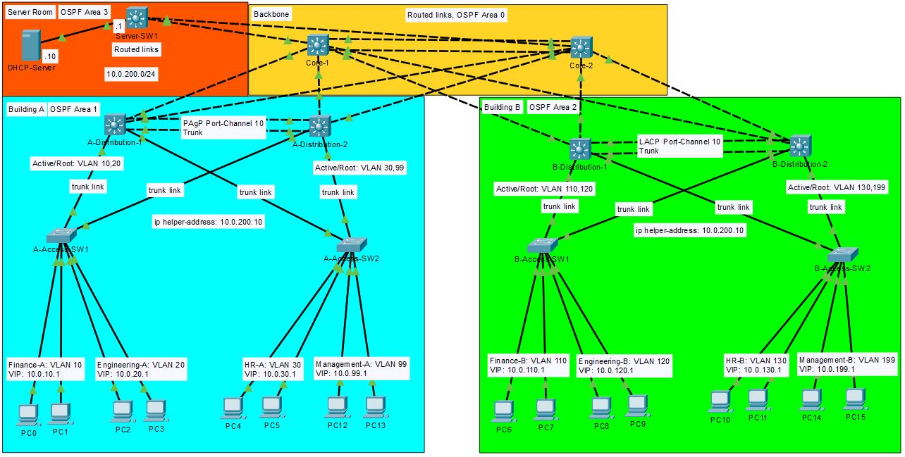

# Lab TNARC Financial HQ: Three-Tier Campus Network

A redundant three-tier campus for TNARC Financial headquarters (Totally Not A Real Company): two office buildings and a server block joined by a core layer, with no single core or distribution switch failure taking users offline.

## The Problem
TNARC's HQ has grown from one building to two, plus a small server room. Today everything sits on one flat network with a single switch per floor. When one switch failed last month, an entire floor lost access for half a day. Leadership has asked for:
    - Departments separated from each other
    - No single switch failure that takes users offline
    - One central DHCP server instead of address pools scattered across devices

## Requirements
1. Each department has its own VLAN, and departments reach each other only through routing.
    - Building A: Finance VLAN 10, Engineering VLAN 20, HR VLAN 30, Management VLAN 99, Access switches trunk VLANs to the distribution switches, where SVIs route them.
    - Building B: Finance VLAN 110, Engineering VLAN 120, HR VLAN 130, Management VLAN 199, Access switches trunk VLANs to the distribution switches, where SVIs route them.
1. Losing any distribution or core switch leaves every user connected
    - HSRP on distribution switches with VIP for each VLAN
2. Hosts in every VLAN, in both buildings, get addresses from the central DHCP Server
    - Create pools for each VLAN in the DHCP server with Default gateway included
    - ip helper-helper address 10.0.200.10 goes on each VLAN's SVI on both distribution switches and points to the DHCP server.
3. Every redundant link is either forwarding or blocked by design
    - STP root priority set per vlan, rapid PVST+ use
4. The design leaves room for more buildings later
    - OSPF Area per building leaves room for new blocks and spare ports on the core.

## Topology

| Layer | Devices | Model | Role |
|-------|---------|-------|------|
| Core | Core-1, Core-2 | 3650 | Routed backbone joining every block |
| Distribution (Building A) | A-Distribution-1, A-Distribution-2 | 3650 | Gateways for Building A VLANs |
| Distribution (Building B) | B-Distribution-1, B-Distribution-2 | 3650 | Gateways for Building B VLANs |
| Access | A-Access-SW1, A-Access-SW2, B-Access-SW1, B-Access-SW2 | 2960 | User ports |
| Server block | Server-SW1 | 3650 | Connects DHCP server and future servers |
| End devices | 2 PCs per VLAN, DHCP-Server | | Testing and Services |
| | | | |

## Network Addressing
| VLAN | Name | Building | Subnet | Gateway (Virtual IP) |
|------|------|----------|--------|----------------------|
| 10 | Finance-A | A | 10.0.10.0/24 | 10.0.10.1 |
| 20 | Engineering-A | A | 10.0.20.0/24 | 10.0.20.1 |
| 30 | HR-A | A | 10.0.30.0/24 | 10.0.30.1 |
| 99 | Management-A | A | 10.0.99.0/24 | 10.0.99.1 |
| 110 | Finance-B | B | 10.0.110.0/24 | 10.0.110.1 |
| 120 | Engineering-B | B | 10.0.120.0/24 | 10.0.120.1 |
| 130 | HR-B | B | 10.0.130.0/24 | 10.0.130.1 |
| 199 | Management-B | B | 10.0.199.0/24 | 10.0.199.1 |
|  | Servers | Server Block | 10.0.200.0/24 | 10.0.200.1 |
| 777 | Native | A and B | | |
| 999 | Unused | A and B | | |
| | | | | | 

[Click for more..](./Network_Addresses.md)

## Key decisions
1. Where does Layer 2 stop and Layer 3 begin?
    - No VLAN spans both buildings, so each building has its own spanning-tree domain. A Layer 2 problem in building A can't affect building B.
2. Trunks or routes links between distribution and core?
    - The main benefits to using routed links instead of trunk links are:
        1. No spanning tree between distribution and core switches, allowing both uplinks to forward instead of one blocking. OSPF load-balances across them as equal-cost paths.
        2. Faster failover, OSPF reroutes when a link drops instead of waiting on STP.
        3. Broadcast and failure domains stay inside each building.
        4. Adding a building means new /30s and a new OSPF area, without touching the existing VLANs.

3. Why does the STP root for each VLAN match its HSRP active router?
    - So traffic can go straight from the access switch to its gateway, without adding an additional hop to the traffic.
4. How do clients in Building B reach a DHCP server on a different subnet?
    - In the SVI corresponding to each vlan a "ip helper-address 10.0.200.10" will be added to point the DHCP requests directly to the DHCP server. There the DHCP pools and default gateway has been configured per VLAN. The helper address is added on both distribution switches to each vlan so DHCP still works if one fails. 
5. How is load shared across the distribution pair?
    - Each Distribution switch is STP primary and HSRP active to two VLANs to reduce the load accross any single switch.  OSPF equal-cost routing across the two uplinks to the Core.

## Verification
| Test | Requirement | Method | Expected | Result |
|------|-------------|--------|----------|--------|
| PC in Finance-A pings PC in Engineering-B | 1 | Ping | Success, routed | [Success](./verification/VLAN_Pings/VLAN_10_Finance-A_to_Building_B/PC_FinanceA_to_PC_Engineering_B.JPG) |
| PC gets an address from DHCP-Server | 3 | ipconfig /renew | 10.0.X.X lease | [Success](./verification/DHCP_Release_Renew/VLAN10_FinanceA.JPG) |
| Power off A-Dist-1 during a continuous ping | 2 | ping -t | Brief loss, then recovers | [Success](./verification/Failover/VLAN10_Ping_A_Distribution_1_powered_off.JPG) |
| Power off Core-1 during a continuous ping | 2 | ping -t | Brief loss, then recovers | [Success](./verification/Failover/PC_VLAN10_Ping_Core_1_Powered_off.JPG) |
| Root bridge matches HSRP active for each VLAN | 4 | show spanning-tree/show standby brief | same switch | [Success](./verification/root_stp_and_standby.md) |
| | | | | |

[Click for more...](./verification/Verification_all.md)

#### Failover results:
- A-Distribution-1: 2 pings were lost and recovery was about 3 seconds, A-Distribution-2 took over.
- Core-1: 0 pings were lost and recovery time was 0 seconds, Core-2 took over.

## Challenges and fixes
1. I tried to router-on-a-stick-style subinterfaces on the 3650,but switches route VLANs with SVIs instead.
    - Fix: ip routing plus "interface vlan xx" to create an SVI per VLAN.

2. OSPF Hello messages on access interfaces in area 2 were causing the VLAN networks to enter a cycle of DOWN/FULL every few seconds. This cycle was making all of the Building B Vlans unreachable across the network. 
    - Even though both interfaces were set to passive the cycle persisted, so to fix it I made VLANs 110,120,130, and 199 passive interfaces.

## What I'd do next?
1. Harden the access layer with DAI, DHCP Snooping, Port Security and BPDU Guard/Filter.
2. Add Web, DNS, NTP and Firewall services across the network.
3. Multi-site WAN with dynamic routing for any branches that need connection to HQ.
4. NOC and Network Management.
5. Enterprise Wireless.

*Built by Gustavo Rodriguez - [LinkedIn](https://www.linkedin.com/in/gustavo-rodriguez-200aab423/)*