## Ping Verifications

| Device | Building | | Department | VLAN | Ping Address | Verification |
|--------|----------|-|------------|------|--------------|--------------|
| PC0 | A | -> | Finance | 110 | 10.0.110.12 |   |
| PC0 | A | -> | Engineering | 120 | 10.0.120.12 |  |
| PC0 | A | -> | HR | 130 | 10.0.130.10 |   |
| PC0 | A | -> | Management | 199 | 10.0.199.11 | 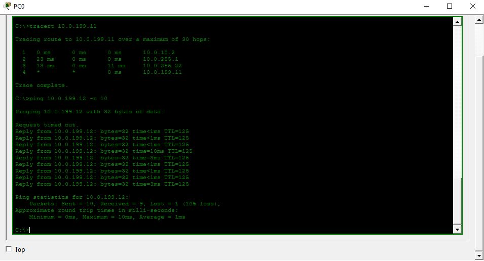 |
| PC2 | A | -> | Finance | 110 | 10.0.110.12 | 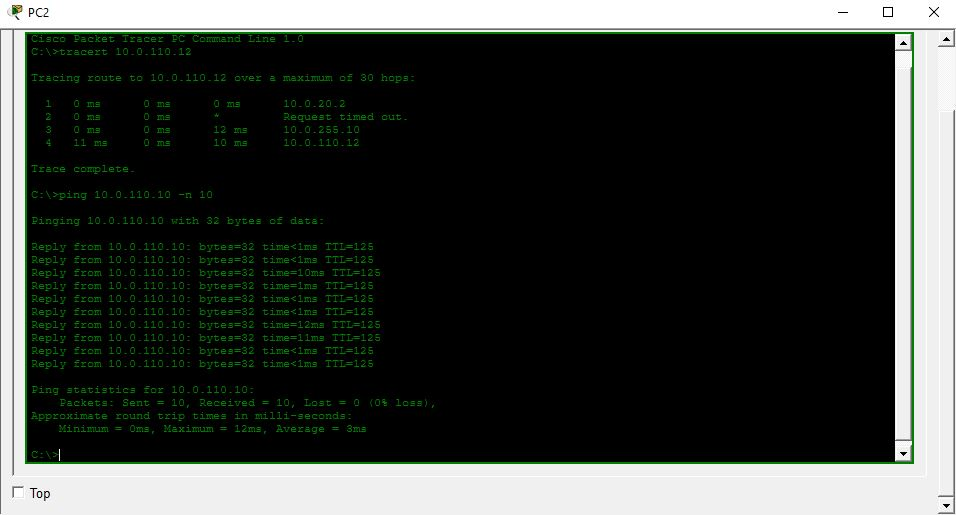 |
| PC2 | A | -> | Engineering | 120 | 10.0.120.12 |  |
| PC2 | A | -> | HR | 130 | 10.0.130.10 |  |
| PC2 | A | -> | Management | 199 | 10.0.199.11 |  |
| PC4 | A | -> | Finance | 110 | 10.0.110.12 |  |
| PC4 | A | -> | Engineering | 120 | 10.0.120.12 | 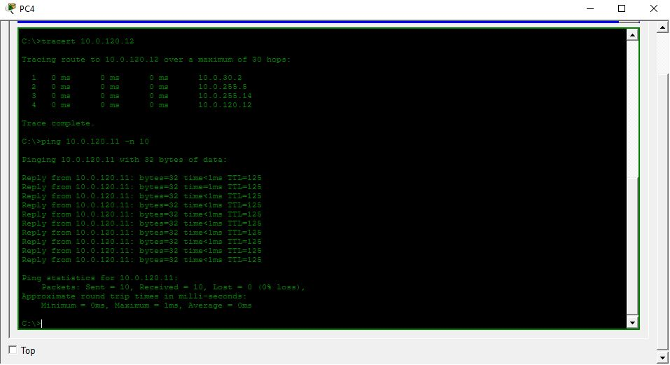 |
| PC4 | A | -> | HR | 130 | 10.0.130.10 | 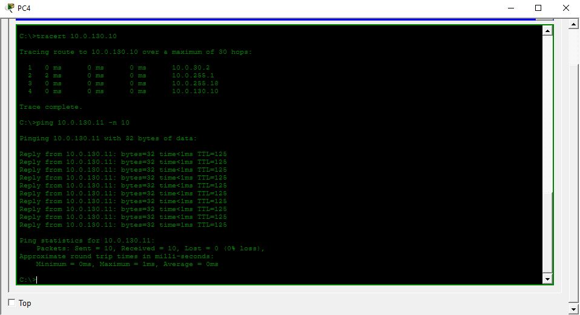 |
| PC4 | A | -> | Management | 199 | 10.0.199.11 |  |
| PC6 | A | -> | Finance | 110 | 10.0.110.12 | 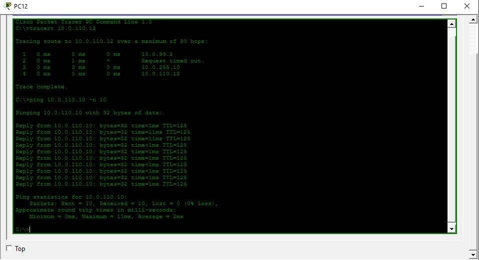 |
| PC6 | A | -> | Engineering | 120 | 10.0.120.12 | 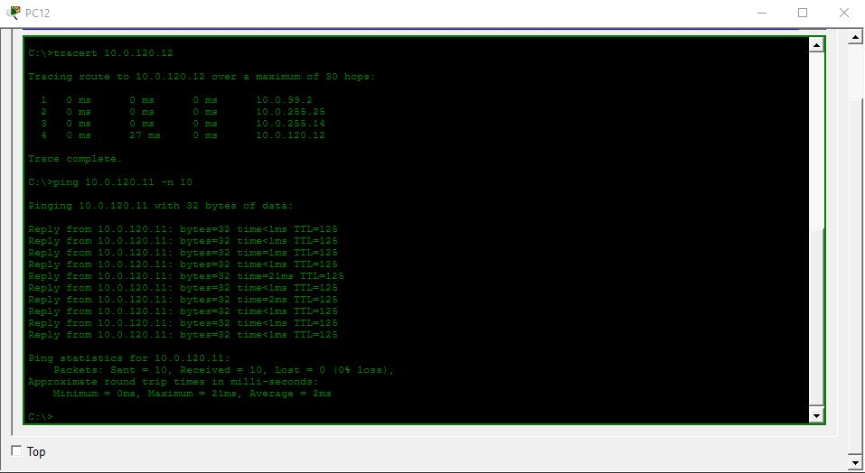 |
| PC6 | A | -> | HR | 130 | 10.0.130.10 |  |
| PC6 | A | -> | Management | 199 | 10.0.199.11 | 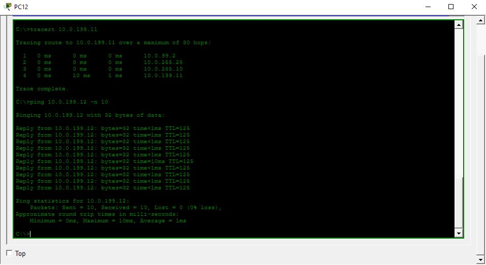 |
| | | | | | | |

## DHCP Release Verifications
| VLAN | Subnet | Verification | 
|------|--------|--------------|
| 10 | 10.0.10.0/24 | 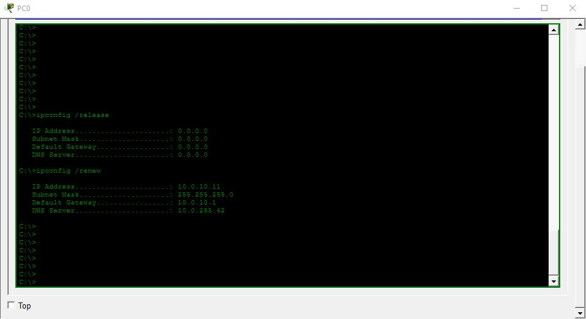 |
| 20 | 10.0.20.0/24 | 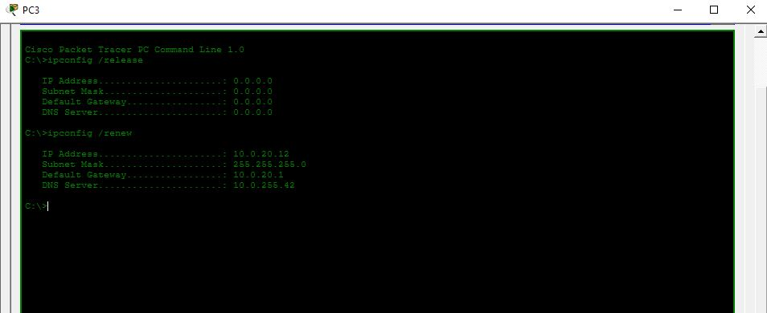 |
| 30 | 10.0.30.0/24 | 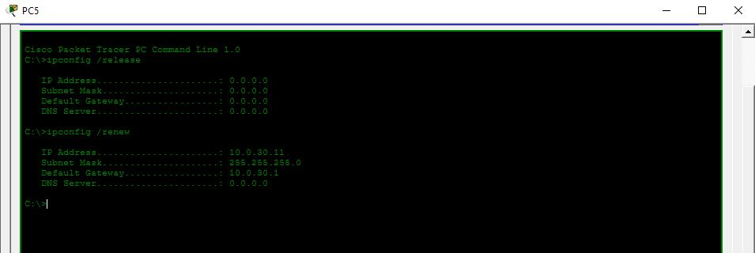 |
| 99 | 10.0.99.0/24 | 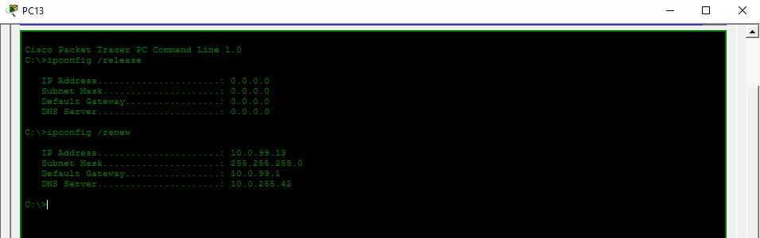 |
| 110 | 10.0.110.0/24 | 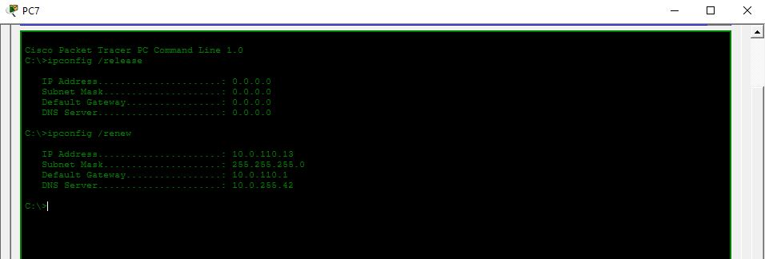 |
| 120 | 10.0.120.0/24 | 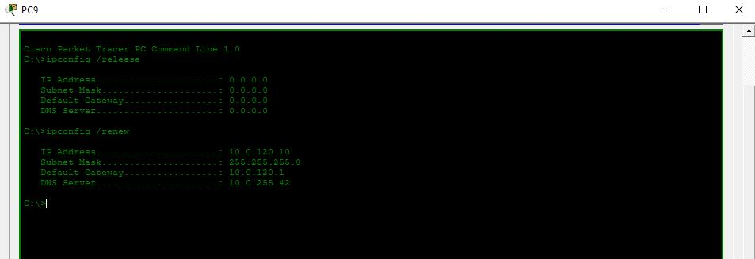 |
| 130 | 10.0.130.0/24 | 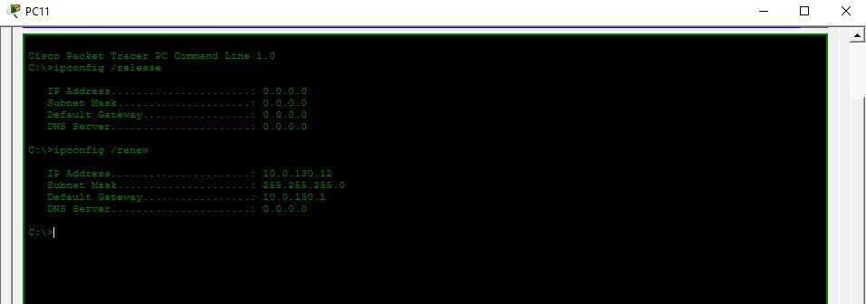 |
| 199 | 10.0.199.0/24 | 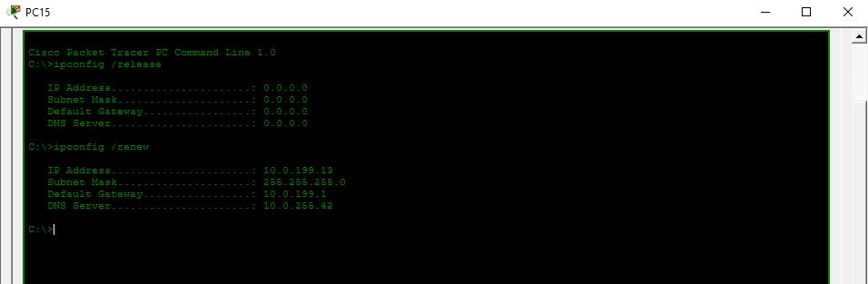 |
| | | |